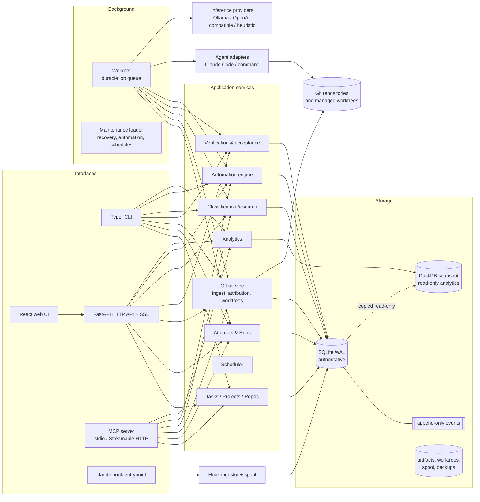
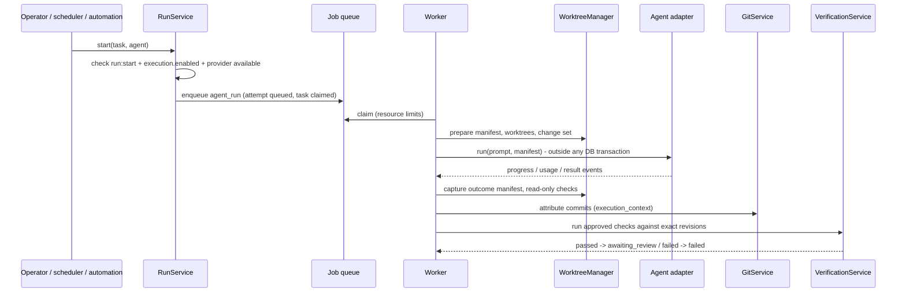

# Architecture

Workgraph is a **modular monolith**: one Python package, one SQLite database, one optional local
server process plus background workers. There are no external brokers or services.

## Layering

| Layer | Package | Rules |
| --- | --- | --- |
| Interfaces | `workgraph.cli`, `workgraph.api`, `workgraph.mcp`, `integrations.claude_code.hook_cli` | Parse input, choose the acting identity, render output. No business rules. |
| Application services | `workgraph.core.services`, `integrations.git`, `orchestration`, `verification`, `classification`, `search`, `automation`, `analytics` | Own transactions, validation, authorization (`security.permissions.require`) and event emission. |
| Domain | `workgraph.core.models`, `core.policies`, `core.events` | Schemas, enums, lifecycle state machines, event log; no framework imports. |
| Persistence | `workgraph.persistence` | ORM schema, Alembic migrations, engine/session management, backups. |
| Integrations | `integrations.agents`, `integrations.llm`, `integrations.process`, `integrations.git.cli` | External processes and HTTP providers behind explicit interfaces. |

The `Workgraph` container (`workgraph/app.py`) wires one instance of each service; every
interface constructs it and calls the same methods, so validation, authorization and auditing
are identical whether a change comes from a human in the UI, a script, or an agent over MCP.

## Transactions and events

- SQLite runs in WAL mode with `busy_timeout`, enforced foreign keys and `BEGIN IMMEDIATE`
  for write transactions (`persistence/db.py`), so concurrent workers never deadlock on lock
  upgrades.
- A service mutation updates current-state tables **and** appends a domain event in the same
  transaction (`core/events/log.py`). The `events` table rejects `UPDATE`/`DELETE` with
  triggers, so history cannot be rewritten by ordinary code.
- Events carry actor, correlation and causation ids, attempt id, schema version and data.
  Upcasters convert old event versions on read. `workgraph events verify` replays the log
  and compares it with the current-state tables.
- External programs, Git commands and model calls never run inside a write transaction:
  services read, release, call out, then write the outcome in a fresh short transaction.

## Background work

The durable queue (`jobs/queue.py`) stores jobs in SQLite with atomic claiming, leases and
heartbeats, retries with exponential backoff, a dead-letter state, idempotency keys,
cancellation and **resource keys** that enforce concurrency limits (`gpu`, `agent:<name>`,
`repo:<id>`, `run`, `exclusive:*`). Workers (`jobs/worker.py`) run handlers in threads; a
crashed worker's jobs are recovered when its lease expires. One worker at a time is elected
(through an expiring lease row) to run maintenance: lease recovery, lost-worker detection,
expired task claims, automation event dispatch, scheduled rules, the agent scheduler,
hook-spool replay and telemetry retention. The same leader queues Jira tracker syncs
(`tracker_sync` jobs, at most one queued or running per connection and mode) on each
`[trackers.<name>]` connection's poll and full-sync intervals (`jobs/trackers.py`).

## Agent runs

An agent's own statement of success never accepts a task; only passing required checks plus
an acceptance decision (automated or recorded manual) does.

## Analytics

`analytics/warehouse.py` copies the needed tables from a read-only SQLite connection into an
in-memory DuckDB database (no extensions, no network) and builds fact tables
(`task_facts`, `attempt_facts`, `task_commits`, `task_files`). The snapshot is rebuilt when the
event log, commit table or change surfaces advance. Metrics come from a registry of explicit
definitions (`analytics/metrics.py`); public interfaces accept only metric ids, allowlisted
dimensions and typed filters - never SQL.
