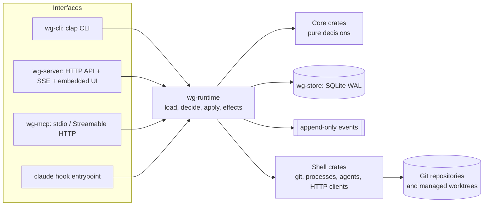
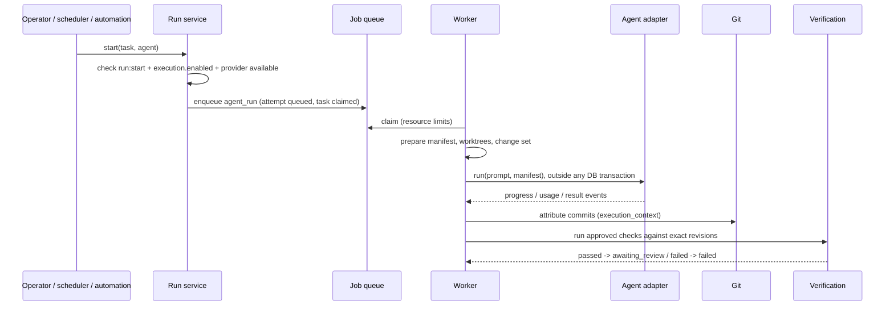

# Architecture

Workgraph is a Cargo workspace that builds one binary, `workgraph`, over one SQLite database. The
`serve` command runs the HTTP API, the web UI and background workers in one local process. There
are no external brokers or services. The design record is [rust-rewrite.md](rust-rewrite.md).

## Crates and purity tiers

Crates fall into tiers, listed in `tools/reports/purity-tiers.txt` and enforced by `cargo purity`
and `cargo lint-arch` (the `arch-lint` crate; `tools/reports/core-rules.toml` holds the Core rules).

| Tier | Crates | Rules |
| --- | --- | --- |
| Core | `wg-tasks`, `wg-registry`, `wg-gitcore`, `wg-exec`, `wg-stacks`, `wg-verify`, `wg-jobs`, `wg-automation`, `wg-intel`, `wg-telemetry`, `wg-trackers`, `wg-experiments`, `wg-analytics`, `wg-events` | Domain logic as pure functions over immutable (`rpds`) values. No I/O, no clock, no entropy. |
| Pure | `wg-json`, `wg-pyrand`, `wg-wire`, `wg-validate`, `wg-render`, `wg-config`, `wg-types`, `wg-model` and the `*spec` crates | No `&mut` in public signatures, no interior mutability, no `std::{time,env,fs,net,process,thread}`. |
| Shell | `wg-store`, `wg-git`, `wg-proc`, `wg-agents`, `wg-net`, `wg-codeparse`, `wg-archive`, `wg-browser`, `wg-runtime` | The only crates that do I/O. A logic ceiling keeps code that could be pure out of them. |
| Interfaces | `wg-cli`, `wg-server`, `wg-mcp` | Parse input, choose the acting identity, render output. No business rules. |
| Features | `wg-*-feature` | Wire one domain to the CLI, HTTP, MCP and job surfaces. Their pure argument and view code sits in `spec` modules. |

`wg-demo-agent` builds `workgraph-demo-agent`, a scripted agent that makes real worktree edits and
commits without any external agent. `wg-conformance` is the behavioural test runner
([testing.md](testing.md)).

## Decide and apply

Every command is `load slice -> decide -> apply`. The shell reads a slice of the database into
persistent values. A pure function returns a `Decision`: row writes, domain events, effects as
data, and the reply. `wg-runtime` applies the writes and events in one `BEGIN IMMEDIATE`
transaction, then interprets the effects. Time, ids and randomness are stamped by the runtime into
each decision's input, so the same slice and stamp always give the same decision.

Long flows (agent runs, verification, stack integration and landing, git sync, tracker sync) are
pure state machines `step(state, input) -> (state, effects)`. Their inputs include the results of
earlier effects.

## Transactions and events

- SQLite runs in WAL mode with a 15 second busy timeout, enforced foreign keys and `BEGIN IMMEDIATE`
  for write transactions, so concurrent workers do not deadlock on lock upgrades.
- A mutation updates current-state tables and appends a domain event in the same transaction. The
  `events` table rejects `UPDATE` and `DELETE` with triggers. Events carry actor, correlation and
  causation ids, attempt id, schema version and data. `workgraph events verify` replays the log and
  compares it with the current-state tables.
- External programs, Git commands and model calls never run inside a write transaction. The
  runtime reads, releases, runs the effect, then writes the outcome in a fresh short transaction.
- The tables and migration revisions are the same as before the Rust port, so an existing database
  opens unchanged.

## Background work

The durable queue (`wg-jobs`, stored in SQLite) has atomic claiming, leases and heartbeats, retries
with exponential backoff, a dead-letter state, idempotency keys, cancellation and resource keys that
enforce concurrency limits (`gpu`, `agent:<name>`, `repo:<id>`, `run`, `exclusive:*`). Workers run
handlers in threads; a crashed worker's jobs are recovered when its lease expires. One worker at a
time, elected through an expiring lease row, runs maintenance: lease recovery, lost-worker
detection, expired task claims, automation event dispatch, scheduled rules, the agent scheduler,
hook-spool replay, telemetry retention and Jira tracker syncs.

## Agent runs

An agent's own statement of success never accepts a task. Only passing required checks plus an
acceptance decision (automated or recorded manual) does.

## Analytics

`wg-analytics` is pure Rust. It builds fact tables (`task_facts`, `attempt_facts`, `task_commits`,
`task_files`) as folds over rows read from SQLite, with no embedded analytics database. Metrics come
from a registry of explicit definitions; public interfaces accept only metric ids, allowlisted
dimensions and typed filters, never SQL.

## Web UI

The React app in `web/` builds with Vite into `web/dist`. `wg-server` embeds that directory at
build time (`crates/wg-server/src/ui.rs`); a debug build reads it from disk. If the directory is
missing, the server shows a page saying the UI has not been built.
