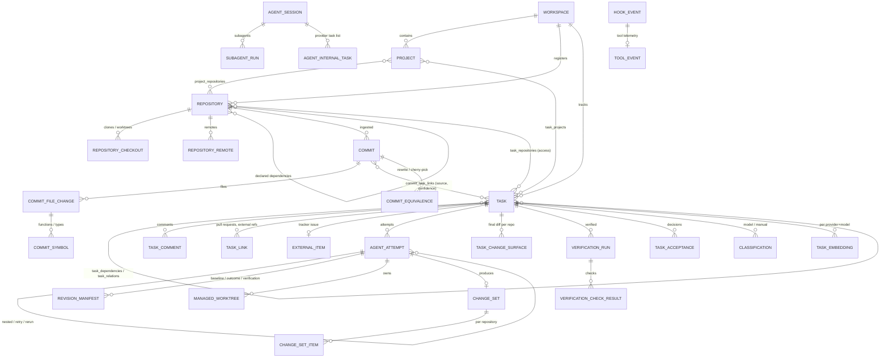

# Data model

All ids are UUIDv4 strings. Timestamps are UTC, stored as sortable ISO-8601 strings.
Tasks additionally have workspace-scoped keys (`WG-104`) that never change when repositories move.

## Key entities

| Table | Purpose |
| --- | --- |
| `workspaces` | Organisational boundary; owns the task key prefix and counter. |
| `projects` | Logical product/initiative; many-to-many with repositories. |
| `repositories` | Canonical identity. `identity_fingerprint` = sorted root-commit SHAs, used to recognise relocated or re-cloned repositories. |
| `repository_checkouts` / `repository_remotes` | Local paths (clone, worktree) and remotes with normalised URLs. |
| `tasks` | Current task state, optimistic `version`, lifecycle timestamps, `current_classification_id`. A tracker-synced task's `key` is the tracker key (`ABC-123`); local tasks keep `<prefix>-<n>`. `number` counts every task in the workspace. |
| `external_items` | The tracker issue a task mirrors (Jira): connection, the tracker's stable id and current key, tracker status and category, the raw snapshot and its hash, sync timestamps and `missing_since`. Unique on `(connection, external_id)`. Written only by the tracker sync. See [Tracker sync](design/tracker-sync.md). |
| `task_links` | Typed links from a task to something outside Workgraph: `kind` (`pull_request`, `external_ref`), `provider`, `url`, `normalized_url`, the `repository_id` it resolved to (null while unregistered), and `sources` (which extractors found it). Unique on `(task_id, kind, normalized_url)`. Replaces `tasks.external_refs`. |
| `task_dependencies`, `task_relations`, `task_tags`, `task_projects`, `task_repositories` | Relationships. Dependencies are global within a workspace (cross-project, cross-repository). |
| `events` | Append-only domain events (`seq`, actor, correlation/causation, attempt, schema version). |
| `agent_attempts` | One execution of a task: provider, adapter, model, session, timings, manifests, measured usage/cost with provenance, telemetry, nesting/retry/rerun links. |
| `revision_manifests` | Exact repository revisions (baseline, outcome, verification, accepted). |
| `managed_worktrees`, `resource_leases` | Worktree ownership/lifecycle and exclusive checkout leases. |
| `change_sets`, `change_set_items` | Cross-repository logical changes with independent per-repository status. |
| `stacks`, `stack_repositories`, `stack_items` | A parent task's children integrated as one unit: base commits per repository and per-child integration state. See [Stacks](#stacks). |
| `experiments`, `experiment_trials` | Measured experiments: a protocol pinned before its first trial, and one row per trial (task, attempt, arm, requested and actual model, outcome, failure cause). See [Experiments](#experiments). |
| `predictor_fits` | A success model fitted over graded trials of one model: coefficients and penalties, the feature and repository layout, the data cutoff, the trial ids used, in-sample metrics and bootstrap coefficient samples. See [Experiments](#experiments). |
| `commits`, `commit_file_changes`, `commit_symbols`, `commit_analyses` | Git metadata, per-file stats, Tree-sitter symbols and analysis provenance (no diff payloads). |
| `commit_task_links` | Attribution with `source` (explicit, execution_context, worktree, trailer, message_inference, rewrite_reconciliation), `confidence` and `evidence`. |
| `commit_equivalences` | Rebased/amended (`rewrite`) or cherry-picked commits. |
| `task_change_surfaces` | Final change surface: baseline vs accepted revision per repository. |
| `git_object_gaps` | Historical objects Workgraph referenced that are no longer available. |
| `verification_configs`, `verification_runs`, `verification_check_results`, `task_acceptances` | Approved checks, runs against manifests, results and acceptance decisions. |
| `classifications`, `classification_gold_labels`, `classification_evaluations`, `task_embeddings` | Inference outputs with full provenance, gold set and evaluations. |
| `jobs`, `job_runs`, `job_resource_claims`, `workers` | Durable queue. |
| `automation_rules`, `automation_runs`, `notifications` | Automation. |
| `agent_sessions`, `session_bindings`, `subagent_runs`, `agent_internal_tasks`, `hook_events`, `tool_events` | Claude Code lifecycle telemetry (redacted). |
| `subagent_runs` (transcript columns) | `requested_model` (sidecar alias), `model` (model that ran), `usage` (summed per message id), `telemetry` (turns, tool counts and errors, markers, versions), `task_id` (FK to `tasks`, `SET NULL`, set only when one task in scope matches the transcript's `Task-ID:`). Null until a transcript is read. |
| `artifacts`, `reports`, `findings` | Files (prompts, logs, reports), retrospectives and failure findings. |
| `task_fts` | SQLite FTS5 index over task text, comments, tags and classification summaries. |

## Task versus attempt state

Task states: `backlog`, `ready`, `blocked`, `claimed`, `running`, `awaiting_verification`,
`awaiting_review`, `accepted`, `failed`, `cancelled`.
Attempt states: `queued`, `preparing`, `running`, `verifying`, `succeeded`, `failed`, `cancelled`,
`timed_out`, `abandoned`. See [task-lifecycle.md](task-lifecycle.md).

## Stacks

A stack belongs to one parent task. `stack_repositories` records, for each repository linked to the
parent or its children, the `base_sha` (the default-branch head of the primary checkout, read when
the stack is created) and the `integration_branch`, `wg/stack/<parent key, lowercased>`. The branch
is named but not created yet. `stack_items` holds one row per child with a state (`pending`,
`ready`, `merged`, `conflict`, `ejected`, `verified`) kept apart from the task lifecycle; `merge_order`
is set the first time an item merges and is kept for replays. A parent has at most one stack in
progress (`status` other than `landed` or `abandoned`), enforced by a partial unique index. Item
transitions are validated in `core/policies/stacks.py`. `stacks.land_request` (migration `0004`) is
null unless a landing was requested while the default branch had moved; it holds the requested mode,
reason and actor until the stack lands (see [Git](git.md#stack-landing)).

## Experiments

An experiment is `draft`, then `running` once frozen, then `closed`. `protocol` holds the arms
(each a name and a pinned full model id, never an alias such as `haiku`), the brief template, the
primary size metric, the band range, the staircase and budget parameters, and optional refine,
repeat, control, gates and seed. It is validated on every write, and once the experiment is frozen
(`frozen_at` set) it cannot change. Validation in `core/policies/experiments.py` reports every problem
at once.

Each `experiment_trials` row is one task, one attempt and one model. The `requested_model` is the
arm's pinned id. `actual_model` is recorded when the run is linked. A trial whose actual model differs
is set to `invalid` with failure cause `wrong_model` and source `mechanical`; invalid trials stay out
of every fit. `seq` orders trials within an experiment. `features` holds the predicted features (at
creation) and the actual ones (under `actual`, at grading). A trial moves `planned` -> `running` ->
`graded` (or `invalid`). `outcome` is `pass` or `fail`, and a failure cause is recorded with its
source (`human`, `agent` or `mechanical`). Trial changes only happen while the experiment is running.

`predictor_fits` rows are immutable. Each one stores the logistic fit of pass on log2 source lines, log2 files and
packages touched, with one repository intercept per repository (shrunk by its own L2 penalty), the latest graded
`graded_at` among its trials as `data_cutoff`, and the `trial_ids` it used. `coef` is intercept first, then the features,
then one indicator per entry of `repositories`. `samples` holds the converged bootstrap refits used for prediction intervals.

## Migrations

Schema changes are Alembic revisions in `src/workgraph/persistence/migrations/versions`.
`workgraph init` (and every process start) upgrades the database; `workgraph doctor` reports the
revision. The FTS5 table and event-immutability triggers are created by raw SQL in `0001`.

`0008` creates `external_items` and `task_links`. `0009` copies each `tasks.external_refs` entry into a
`task_links` row (`kind = external_ref`, `sources = ["migrated"]`, `created_by = system:migration`, deduplicated by
`system:id`) and then drops the column. Its downgrade deletes the `external_ref` rows and re-adds the column with empty
lists.
