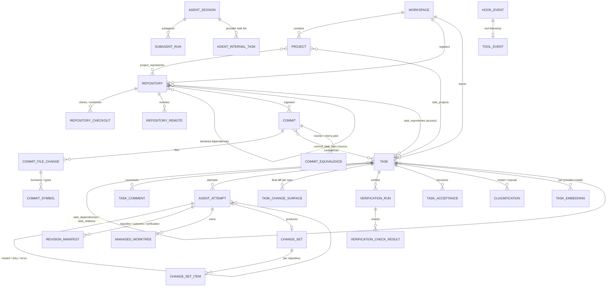

# Data model

All ids are UUIDv4 strings. Timestamps are UTC, stored as sortable ISO-8601 strings.
Tasks additionally have workspace-scoped keys (`WG-104`) that never change when repositories move.

## Key entities

| Table | Purpose |
| --- | --- |
| `workspaces` | Organisational boundary; owns the task key prefix and counter. |
| `projects` | Logical product/initiative; many-to-many with repositories. |
| `repositories` | Canonical identity. `identity_fingerprint` = sorted root-commit SHAs, used to recognise relocated or re-cloned repositories. |
| `repository_checkouts` / `repository_remotes` | Local paths (clone, worktree) and remotes with normalised URLs. |
| `tasks` | Current task state, optimistic `version`, lifecycle timestamps, `current_classification_id`. |
| `task_dependencies`, `task_relations`, `task_tags`, `task_projects`, `task_repositories` | Relationships. Dependencies are global within a workspace (cross-project, cross-repository). |
| `events` | Append-only domain events (`seq`, actor, correlation/causation, attempt, schema version). |
| `agent_attempts` | One execution of a task: provider, adapter, model, session, timings, manifests, measured usage/cost with provenance, telemetry, nesting/retry/rerun links. |
| `revision_manifests` | Exact repository revisions (baseline, outcome, verification, accepted). |
| `managed_worktrees`, `resource_leases` | Worktree ownership/lifecycle and exclusive checkout leases. |
| `change_sets`, `change_set_items` | Cross-repository logical changes with independent per-repository status. |
| `commits`, `commit_file_changes`, `commit_symbols`, `commit_analyses` | Git metadata, per-file stats, Tree-sitter symbols and analysis provenance (no diff payloads). |
| `commit_task_links` | Attribution with `source` (explicit, execution_context, worktree, trailer, message_inference, rewrite_reconciliation), `confidence` and `evidence`. |
| `commit_equivalences` | Rebased/amended (`rewrite`) or cherry-picked commits. |
| `task_change_surfaces` | Final change surface: baseline vs accepted revision per repository. |
| `git_object_gaps` | Historical objects Workgraph referenced that are no longer available. |
| `verification_configs`, `verification_runs`, `verification_check_results`, `task_acceptances` | Approved checks, runs against manifests, results and acceptance decisions. |
| `classifications`, `classification_gold_labels`, `classification_evaluations`, `task_embeddings` | Inference outputs with full provenance, gold set and evaluations. |
| `jobs`, `job_runs`, `job_resource_claims`, `workers` | Durable queue. |
| `automation_rules`, `automation_runs`, `notifications` | Automation. |
| `agent_sessions`, `session_bindings`, `subagent_runs`, `agent_internal_tasks`, `hook_events`, `tool_events` | Claude Code lifecycle telemetry (redacted). |
| `artifacts`, `reports`, `findings` | Files (prompts, logs, reports), retrospectives and failure findings. |
| `task_fts` | SQLite FTS5 index over task text, comments, tags and classification summaries. |

## Task versus attempt state

Task states: `backlog`, `ready`, `blocked`, `claimed`, `running`, `awaiting_verification`,
`awaiting_review`, `accepted`, `failed`, `cancelled`.
Attempt states: `queued`, `preparing`, `running`, `verifying`, `succeeded`, `failed`, `cancelled`,
`timed_out`, `abandoned`. See [task-lifecycle.md](task-lifecycle.md).

## Migrations

Schema changes are Alembic revisions in `src/workgraph/persistence/migrations/versions`.
`workgraph init` (and every process start) upgrades the database; `workgraph doctor` reports the
revision. The FTS5 table and event-immutability triggers are created by raw SQL in `0001`.
