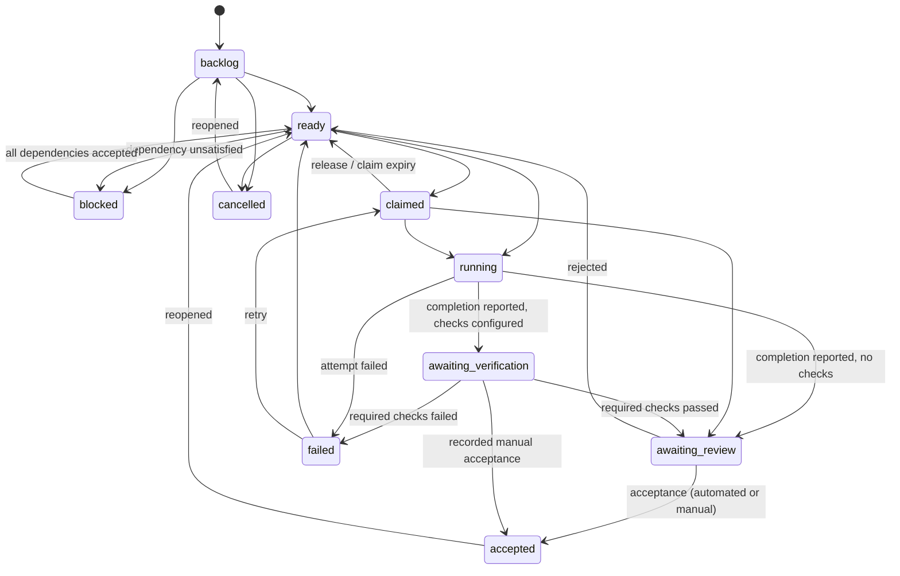

# Task lifecycle, verification and acceptance

## States



Transitions are validated by `core/policies/lifecycle.py`. Notable rules:

- **Completion is a claim, not acceptance.** `task complete` / `task_complete` /
  `task_report_result succeeded` move a task to `awaiting_verification` (when checks apply) or
  `awaiting_review`. Only the acceptance service can enter `accepted`.
- Moving to `ready` with unaccepted dependencies lands in `blocked` (reason `dependencies`);
  accepting the last blocker returns dependents to `ready` and emits `task.became_ready`.
  Claiming or running a task with unaccepted dependencies is rejected.
- **Inside a stack, a sibling dependency is satisfied earlier.** When both tasks are items of the
  same active stack, the dependency counts as satisfied once its stack item is `ready`, `merged` or
  `verified` (integration-ready), without acceptance. Setting the item to any of those states
  promotes its blocked dependents; leaving them, or removing the item from the stack, blocks them
  again. Dependencies on tasks outside the stack keep the accepted-only rule. Every satisfaction
  check goes through `satisfied_dependencies` in `core/services/tasks.py`.
- Dependencies are workspace-wide (across projects and repositories); cycles in dependencies and
  in the parent hierarchy are rejected with the offending path.
- Claims are exclusive leases; an expired claim is released by maintenance.
- Reopening accepted or cancelled work emits `task.reopened` (counted by the quality metrics).
- Updates accept `expected_version` for optimistic concurrency (`version_conflict` on mismatch).
- Records are archived, never deleted.

Parent tasks show a rollup of descendants (`by_status`, accepted count, progress).

## Attempts

Attempt states: `queued -> preparing -> running -> verifying -> succeeded`, or `failed`,
`timed_out`, `cancelled`, `abandoned`. Attempts are never deleted; retries (`retry_of`),
reruns (`rerun_of`) and nested subagent attempts (`parent_attempt_id`) are linked.
After `execution.max_attempts_per_task` failures the task is tagged `needs-review`
(`task.escalated`) and the scheduler stops retrying it.

## Verification

Verification configurations are **trusted configuration**: only actors with `config:manage`
(humans by default) can create them, and commands are argument vectors (no shell; a shell
interpreter as executable needs `allow_shell: true`).

```sh
uv run workgraph verify config ci --scope-type repository --scope api --check "{\"name\": \"tests\", \"kind\": \"test\", \"command\": [\"uv\", \"run\", \"pytest\", \"-q\"]}"
uv run workgraph verify config integration --scope-type project --scope platform --check "{\"name\": \"contract\", \"kind\": \"integration\", \"command\": [\"python\", \"tools/contract.py\"], \"timeout_seconds\": 600}"
```

Scopes: `workspace`, `project`, `repository` (runs in that repository's checkout), `task`.
Check fields: `name`, `kind` (test, lint, typecheck, build, integration, custom), `command`,
`repository`, `timeout_seconds`, `required`, `env`, `parser` (auto, pytest, generic), `tier`
(`fast` or `full`, default `full`).

Tiers select checks by cost. `fast` checks (lint, format, type check) are the ones an agent is told
to run itself: they are listed as `agent_checks` in the execution manifest. `workgraph verify run
--tier fast` runs only those checks, and a run restricted to the fast tier cannot accept a task
while full-tier checks exist. A run without `--tier` runs every check, as before.

A run records the exact revision manifest under test, each check's exit code, duration, timeout,
log artifact, output excerpt and parsed failure signatures (e.g. `test:tests/test_api.py::test_login`).
Integration checks run in a scratch directory with `WORKGRAPH_MANIFEST` and
`WORKGRAPH_REPO_<NAME>_PATH` for every repository in the manifest.

```sh
uv run workgraph verify run WG-12
uv run workgraph verify failures --check "unit tests"
```

## Acceptance

- **Automated**: `workgraph task accept WG-12` requires that the latest verification run passed
  all required checks.
- **Manual**: `workgraph task accept WG-12 --manual --reason "reviewed the diff"` records an
  explicit decision by the actor (required for tasks with no automated checks).
- **Reject**: `workgraph task reject WG-12 --reason "..."` sends the work back to `ready`.

Acceptance stores the accepted revision manifest and queues the final-change-surface computation.
Workgraph never merges, pushes or publishes accepted work.
